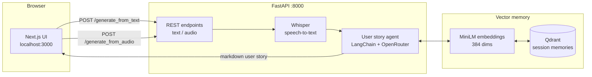

# Agile User Story Generator

[](https://github.com/Mohammad-Ali-Rauf/business_analyst_v2/actions/workflows/ci.yml)
[](LICENSE)

Turn rough feature ideas — typed descriptions **or voice notes** — into
backlog-ready agile user stories, complete with context, acceptance criteria,
security requirements and test scenarios.

The assistant remembers your session, so follow-up requests naturally build on
the stories it generated before.

## Quick start

```bash
cp .env.example .env        # then paste your LLM API key into .env
docker compose up --build
```

Open **http://localhost:3000**. That's it — full setup details, manual
installation and configuration options are below.

## Sample output

Given _"As a shopper, I want to save items to a wishlist so that I can buy
them later"_, the assistant returns:

```markdown
## User Story

As a shopper,
I want to save items to a wishlist,
So that I can review my saved items and buy them later.

## Context

Wishlists let shoppers shortlist products across sessions without committing
to a purchase, directly supporting return visits and higher conversion. The
feature needs a per-user persisted collection with fast add/remove feedback in
the UI.

## Acceptance Criteria

- A signed-in shopper can add any product to their wishlist from the product page
- The wishlist page lists saved items with name, price and a link to the product
- Items can be removed from the wishlist with immediate visual feedback
- Adding an item that is already in the wishlist is a no-op with a clear message

## Security Requirements

- Only the authenticated owner can read or modify a wishlist
- Wishlist mutations are rate limited to prevent scripted abuse

## Test Scenarios

- Happy path: add a product, see it on the wishlist page, remove it
- Guest user is prompted to sign in when adding to the wishlist
- Adding a duplicate item shows "already in your wishlist"
- Removing the last item shows the empty-wishlist state
```

*(Example of the document structure the app produces; actual stories vary with
the model and input.)*

## Screenshot

<!--  -->

> To add one: run the stack, capture the UI and save it as `docs/screenshot.png`,
> then uncomment the line above.

## Features

- **Text → user story** — describe a feature in plain language and get a
  structured markdown document (User Story, Context, Acceptance Criteria,
  Security Requirements, Test Scenarios).
- **Audio → user story** — upload a voice note; it is transcribed locally with
  OpenAI Whisper and fed through the same pipeline.
- **Session memory** — inputs and generated stories are embedded and stored in
  Qdrant per session token; the most recent exchanges are replayed into the
  prompt so later stories reference earlier ones.
- **Polished UI** — dark, responsive interface with sample prompts, drag & drop
  upload, skeleton loading states, copy-to-clipboard and one-click
  **Download .md**.
- **Production-friendly backend** — FastAPI with typed endpoints, input
  validation, size limits, structured logging, health checks and
  environment-driven configuration.
- **Provider-agnostic LLM** — any OpenAI-compatible chat endpoint works;
  OpenRouter is the default, with Gemini, Claude, GPT and open models a
  one-line config change away.

## Architecture



**Request flow:** the API receives a feature description (or transcribes an
audio file), fetches the session's recent memories from Qdrant, prompts the
configured LLM (OpenRouter by default) with that history + the new input, then
stores both the input and the generated document back into memory.

## Tech stack

| Layer      | Technology                                              |
| ---------- | ------------------------------------------------------- |
| Frontend   | Next.js 15 (App Router), React 19, Tailwind CSS 4, TypeScript |
| Backend    | FastAPI, Uvicorn                                        |
| LLM        | Any OpenAI-compatible provider (OpenRouter by default) via `langchain-openai` |
| Speech     | OpenAI Whisper (local, CPU)                             |
| Memory     | Qdrant + `sentence-transformers/all-MiniLM-L6-v2`       |
| Testing    | pytest (backend), vitest + Testing Library (frontend)    |
| Deployment | Docker Compose                                          |

## Project structure

```
.
├── compose.yml              # Qdrant + FastAPI + Next.js
├── .env.example             # Configuration template
├── .github/workflows/       # CI: lint, tests, type-check, Docker build
├── LICENSE                  # MIT
├── server/                  # FastAPI backend
│   ├── main.py              # API entrypoint and routes
│   ├── config.py            # Environment-driven settings
│   ├── agents/
│   │   └── user_story_agent.py   # Prompting + LLM calls + memory hooks
│   ├── tests/               # Pytest suite (LLM + memory stubbed)
│   └── utils/
│       ├── audio_to_text.py      # Lazy-loaded Whisper transcription
│       └── memory_manager.py     # Qdrant session memory
└── frontend/                # Next.js frontend (pnpm)
    └── src/
        ├── app/             # Layout, page, global styles
        ├── components/      # InputPanel, OutputPanel
        ├── lib/api.ts       # Typed API client
        └── test/            # Vitest setup
```

## Getting started

### Prerequisites

- Docker + Docker Compose (recommended), or Node 22+ with
  [pnpm](https://pnpm.io) (`corepack enable`) and Python 3.12 for a manual
  setup
- An LLM API key — an [OpenRouter](https://openrouter.ai/keys) key by default,
  or a key from any OpenAI-compatible provider

### Run with Docker Compose

```bash
cp .env.example .env        # then paste your LLM API key into .env
docker compose up --build
```

| Service    | URL                          |
| ---------- | ---------------------------- |
| Frontend   | http://localhost:3000        |
| API        | http://localhost:8000        |
| API docs   | http://localhost:8000/docs   |
| Qdrant     | http://localhost:6333        |

> The first request downloads the Whisper model and the embedding model, so it
> may take a little longer to respond.

### Run manually (development)

**Backend** — from `server/`:

```bash
python -m venv .venv && source .venv/bin/activate
pip install torch==2.15.0+cpu --index-url https://download.pytorch.org/whl/cpu
pip install -r requirements.txt
cp ../.env.example ../.env                                                 # add your API key
uvicorn main:app --reload --port 8000
```

> Whisper also needs `ffmpeg` installed on your system. The pinned
> `torch==2.15.0+cpu` wheel keeps the install several GB smaller than the
> default CUDA build.

**Frontend** — from `frontend/`:

```bash
corepack enable
pnpm install
pnpm dev                       # http://localhost:3000
```

Point the UI at a non-default backend with
`NEXT_PUBLIC_API_URL=http://localhost:8000 pnpm dev`.

## Tests

Both suites run fully offline — the LLM client and vector memory are stubbed,
so no API keys are needed.

```bash
# Backend (from server/)
pip install -r requirements-dev.txt
python -m pytest

# Frontend (from frontend/)
pnpm test
```

CI runs the same suites plus `ruff`, `tsc --noEmit`, the production build and a
Docker image build on every push.

## Configuration

All settings are optional except `LLM_API_KEY`.

| Variable            | Default                                    | Description                              |
| ------------------- | ------------------------------------------ | ---------------------------------------- |
| `LLM_API_KEY`       | —                                          | LLM API key (**required**)               |
| `NEXT_PUBLIC_API_URL` | `http://localhost:8000`                  | Backend URL baked into the frontend      |
| `LLM_MODEL`         | `google/gemini-3.8-flash`                  | Any model id served by the provider      |
| `LLM_BASE_URL`      | `https://openrouter.ai/api/v1`             | OpenAI-compatible chat endpoint          |
| `LLM_HTTP_REFERER`  | —                                          | Optional app attribution URL (OpenRouter) |
| `LLM_TEMPERATURE`   | `0.7`                                      | Sampling temperature                     |
| `WHISPER_MODEL`     | `base`                                     | Whisper model size (`tiny`…`large`)      |
| `QDRANT_URL`        | `http://qdrant:6333`                       | Qdrant endpoint                          |
| `MEMORY_COLLECTION` | `user_memory`                              | Qdrant collection name                   |
| `MEMORY_TOP_K`      | `5`                                        | Memories replayed into the prompt        |
| `EMBEDDING_MODEL`   | `sentence-transformers/all-MiniLM-L6-v2`   | Embedding model                          |
| `ALLOWED_ORIGINS`   | `*`                                        | Comma-separated CORS origins             |
| `MAX_AUDIO_BYTES`   | `26214400` (25 MB)                         | Max uploaded audio size                  |

## API reference

Interactive documentation is served at **http://localhost:8000/docs**.

### `POST /generate_from_text`

| Field   | Type | Description                                  |
| ------- | ---- | -------------------------------------------- |
| `text`  | form | Feature description                          |
| `token` | form | Session token (scopes conversation memory)   |

```bash
curl -X POST http://localhost:8000/generate_from_text \
  -F "text=As a shopper, I want to save items to a wishlist" \
  -F "token=demo-session"
```

```json
{ "story": "## User Story\n\nAs a shopper, ..." }
```

### `POST /generate_from_audio`

| Field  | Type  | Description                                 |
| ------ | ----- | ------------------------------------------- |
| `file` | file  | Audio note (wav, mp3, m4a, …) up to 25 MB   |
| `token`| form  | Session token                               |

```bash
curl -X POST http://localhost:8000/generate_from_audio \
  -F "file=@voice-note.wav" \
  -F "token=demo-session"
```

```json
{ "transcription": "…", "story": "## User Story\n\n…" }
```

### `GET /health`

Returns `{"status": "ok"}` — used by the Docker health check.

## Notes & limitations

- Conversation memory is keyed by a token generated in the browser
  (`localStorage`), not by authentication — treat it as per-browser state, not
  user accounts.
- Whisper runs locally on CPU; `base` is a good speed/quality trade-off — set
  `WHISPER_MODEL=tiny` on small machines or `small`/`medium` for better
  accuracy.
- Generated stories are drafts. Always review them before adding to a backlog.

## Roadmap

- [ ] Export stories directly to Jira / Trello
- [ ] Editable stories with in-place regeneration
- [ ] Per-story memory pruning and management
- [ ] Authentication and shared team sessions

## License

[MIT](LICENSE)
